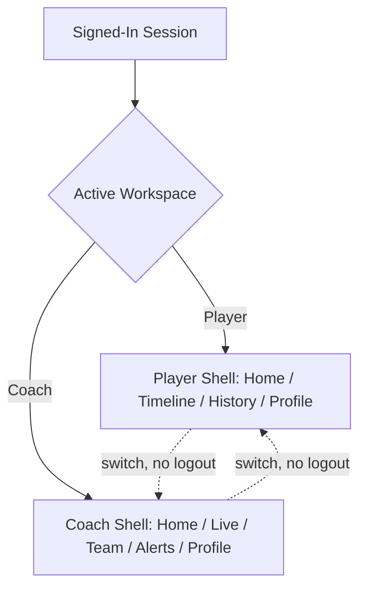
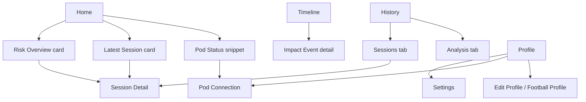
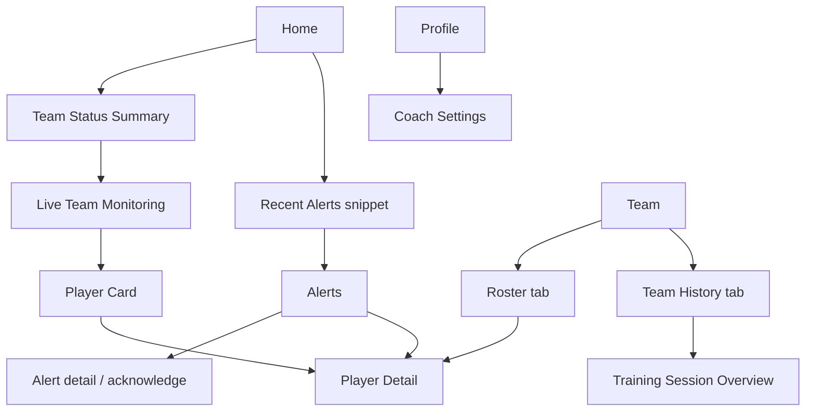
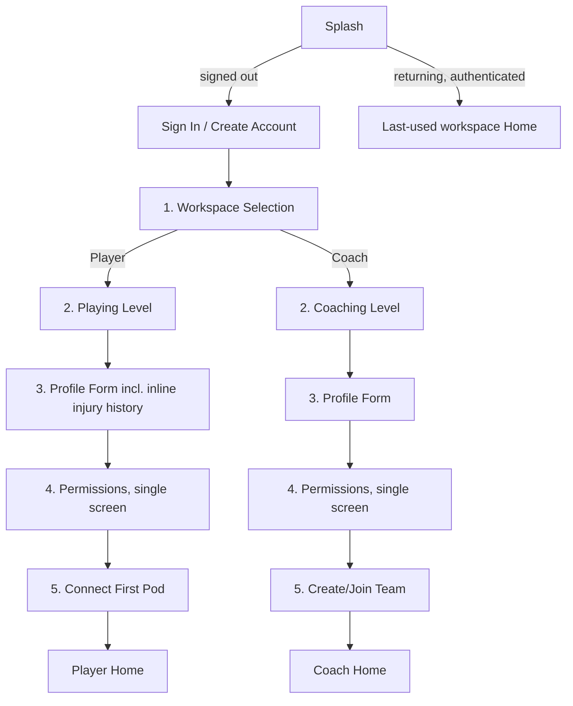
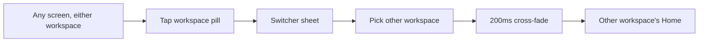
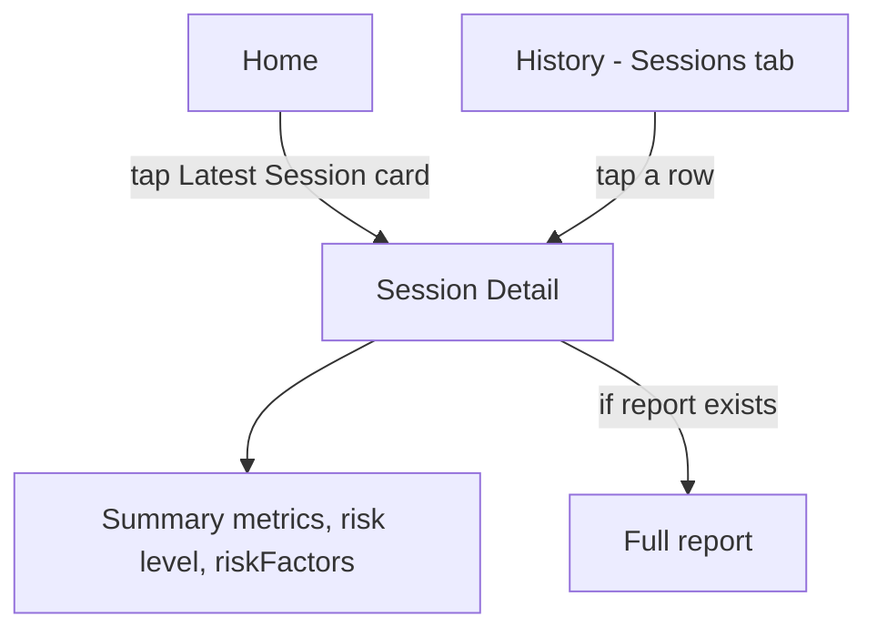
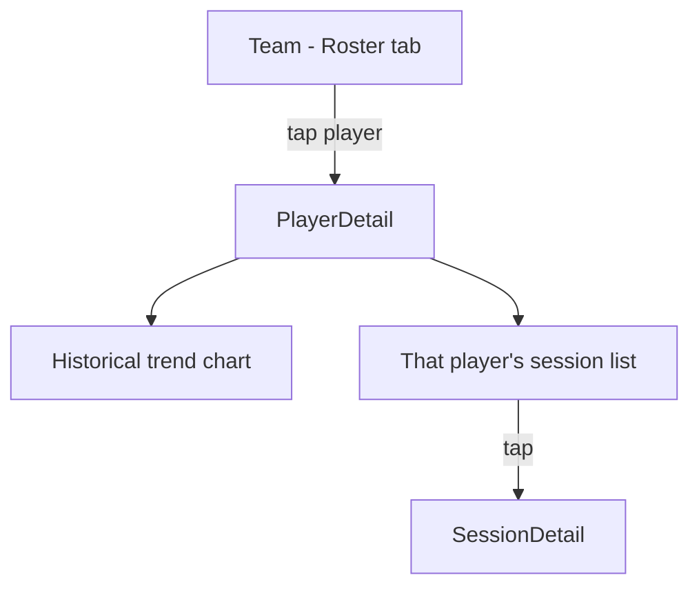

# Vikzar Product Design Specification

**Status:** **Frozen.** Phase 2A (Product Design & UX Architecture) drafted, then audited and corrected during the Phase 2 freeze review. This is the permanent, official design specification for the Vikzar application, binding for Phase 3.

**Owner:** Head of Product Design

This document contains no Flutter code, no widgets, no Dart, and no implementation. It is the frozen product experience that Phase 3 onward (Project Initialization & implementation phases) builds against. Where this document specifies a visual or interaction detail, it is binding until superseded by a recorded decision in [DECISIONS.md](DECISIONS.md).

**Source of truth acknowledged:** this document was written after, and is fully consistent with, [ARCHITECTURE.md](ARCHITECTURE.md), [SPECIFICATION.md](SPECIFICATION.md), [BACKEND_SPECIFICATION.md](BACKEND_SPECIFICATION.md), [ROADMAP.md](ROADMAP.md), [DECISIONS.md](DECISIONS.md), and [CHANGELOG.md](CHANGELOG.md). Nothing below contradicts a settled architecture decision. Exactly one tension between this phase's product direction and the current data model is identified and flagged, not silently resolved — see "Architecture Reconciliation Note" below.

**Design references:** screenshots from Nike Training Club were reviewed for aesthetic qualities only — whitespace, spacing rhythm, typographic confidence, calm information density, onboarding pacing, and premium restraint. No layout, wordmark, icon, copy, or asset from those references is reproduced anywhere in this document or is to be reproduced in the product. Vikzar's visual identity (below) is deliberately distinct: a dark, precision-instrument aesthetic (closer to Apple Health, WHOOP, and Linear) rather than Nike's bold athletic-brand energy. Someone should never mistake Vikzar for Nike.

---

## Table of Contents

- [Architecture Reconciliation Note](#architecture-reconciliation-note)
- [Brand Foundation](#brand-foundation)
1. [Product Vision](#1-product-vision)
2. [UX Principles](#2-ux-principles)
3. [Design Philosophy](#3-design-philosophy)
4. [Visual Language](#4-visual-language)
5. [Typography System](#5-typography-system)
6. [Spacing System](#6-spacing-system)
7. [Grid System](#7-grid-system)
8. [Colour Usage Rules](#8-colour-usage-rules)
9. [Elevation Rules](#9-elevation-rules)
10. [Corner Radius Rules](#10-corner-radius-rules)
11. [Iconography Rules](#11-iconography-rules)
12. [Motion Principles](#12-motion-principles)
13. [Navigation Architecture](#13-navigation-architecture)
14. [Player Workspace Information Architecture](#14-player-workspace-information-architecture)
15. [Coach Workspace Information Architecture](#15-coach-workspace-information-architecture)
16. [Complete Screen Inventory](#16-complete-screen-inventory)
17. [Complete User Flows](#17-complete-user-flows)
18. [Component Library](#18-component-library)
19. [Low-Fidelity Wireframe Descriptions](#19-low-fidelity-wireframe-descriptions)
20. [Accessibility](#20-accessibility)
21. [Responsive Behaviour](#21-responsive-behaviour)
22. [Future Expansion](#22-future-expansion)
- [Assumptions](#assumptions)
- [Open Questions](#open-questions)
- [Document Control](#document-control)

---

## Architecture Reconciliation Note

**Resolved at the Phase 2 freeze review.** This phase originally made one product decision with a data-model consequence not yet reflected in the backend: **a single account can hold both a Player workspace and a Coach workspace, switchable without logout** (see Absolute Product Decision 3, below). At the time this document was first drafted, the Firestore schema modeled `users/{uid}.role` as a single required enum, which didn't support that. Per the instruction at the time to preserve architecture over design rather than silently redesign the schema, that tension was recorded as a tracked, unresolved decision rather than fixed in place.

It has since been resolved, deliberately and explicitly, not silently:

- [DECISIONS.md ADR-031](DECISIONS.md#adr-031-single-application-with-player-and-coach-workspace-switching) now records both the UX-level decision and its finalized data model: `users/{uid}.workspaces` (a structured object, one optional key per workspace held) and `users/{uid}.defaultWorkspace` (onboarding-time fallback only — the *currently active* workspace is local device state, never stored server-side).
- [BACKEND_SPECIFICATION.md §1.5](BACKEND_SPECIFICATION.md#1-complete-firestore-schema) implements this shape as the authoritative schema.
- [SPECIFICATION.md §4.3](SPECIFICATION.md#4-user-roles) records the product decision and its now-finalized data-model mechanism together — nothing remains open on this question.

Everything else in this document — the laptop-centric MVP architecture, the absence of any BLE/pairing UI in the Flutter app, the Firestore-driven read-only data surfaces — was, and remains, designed in full agreement with the frozen architecture.

---

## Brand Foundation

### Identity

| Field | Value |
|---|---|
| Name | VIKZAR |
| Tagline | Know Every Impact. |
| Category | Football injury intelligence platform — explicitly not a workout app, fitness app, running tracker, or sports social network |
| Feeling | Precision, confidence, elite technology, trust, performance, calm, professionalism |

### Logo and Icon

The official Vikzar wordmark (arrow/chevron mark + "VIKZAR" type) and the standalone icon mark are fixed brand assets, provided directly and used as-is throughout the product. **This document does not redesign, reinterpret, or propose variants of the logo or icon.** Usage rules only:

- **Clear space:** minimum clear space around the full lockup equals the height of the arrow mark, on all sides, in any placement.
- **Minimum size:** the full lockup is never rendered below 96dp wide in-product; the standalone icon mark (app icon, favicon-equivalent contexts, compact avatar/badge use) is never rendered below 24dp.
- **On-dark:** the icon mark renders in Warm Ivory or pure white on Plum Black / Graphite Ink surfaces (as shown in the provided asset).
- **On-light:** the icon mark renders in Plum Black on Warm Ivory / white surfaces.
- **Never:** never recolor the mark outside the approved on-dark/on-light pair, never rotate it, never place it on a busy photographic background without a solid-color safe area beneath it, never pair it with a different wordmark treatment.
- **Splash/launch use:** the standalone icon mark is the only element on the splash screen (see [§19.1](#191-onboarding-flow)) — no wordmark, no tagline, no supporting copy at launch.

### Official Colour Palette

| Token Name | Hex | Description |
|---|---|---|
| Plum Black | `#17131E` | Primary dark background — near-black with a cool violet undertone |
| Graphite Ink | `#17191D` | Secondary dark surface — near-identical value to Plum Black by design, used for the subtlest possible layering distinction (see [§9](#9-elevation-rules)) |
| Mineral Blue | `#597C80` | Primary accent — muted teal-blue; calm, trustworthy, data-forward |
| Oxide Rose | `#9E5C55` | Secondary accent — muted warm rust; used for attention without alarm |
| Warm Ivory | `#F2E9E7` | Primary light surface / primary text-on-dark |

These five colours are the entire approved brand palette. Full usage rules, including the one deliberate, flagged exception for safety-critical alerting, are in [§8](#8-colour-usage-rules).

---

## 1. Product Vision

Vikzar makes the invisible cost of football — repeated and severe physical impact — visible, specific, and actionable, for the two people positioned to act on it: the player wearing the hardware, and the coach responsible for the squad. The application is the single place either of them looks to understand what happened to a body during a session, in language and visuals precise enough to be trusted and calm enough to be trusted *under pressure* — during a live match, in front of a team, in the seconds after a hard tackle.

Vikzar is not trying to be a companion to training motivation. It is trying to be the instrument a serious football environment relies on the way a cockpit relies on its instruments: legible at a glance, precise on inspection, and never wrong about the one number that matters most in the moment.

## 2. UX Principles

These extend [PRODUCT_PRINCIPLES.md](PRODUCT_PRINCIPLES.md) into UX-specific rules. Every screen and flow in this document is checked against these.

1. **Risk is always legible in under one second.** Whatever screen a coach or player is on, the current risk state (theirs, or their team's) is never more than a glance away and never requires interpretation of a chart to understand at the coarsest level (normal / elevated / high).
2. **Color never carries meaning alone.** Every risk-level, status, or alert indicator pairs color with a label, icon, or both — never color in isolation (this is both an accessibility rule, [§20](#20-accessibility), and a trust rule: a safety product cannot ask a colorblind coach to guess).
3. **Data density scales with expertise and screen size, never with clutter.** A player's home screen shows less than a coach's live monitoring grid, and a phone shows less than a desktop — but nothing is ever added "because there's room." Every additional element on a larger surface must earn its place.
4. **No dead ends.** Every screen — including every empty, loading, and error state — has a next action. A player with no sessions yet is told exactly what to do next, not shown a blank page.
5. **Workspace switching is instant and always reversible.** Switching between Player and Coach is treated with the same weight as switching a tab, never the weight of switching accounts — no confirmation dialog, no reload flash, no re-authentication.
6. **The interface is quiet until it needs to speak.** Motion, color intensity, and visual weight are reserved for genuinely important state changes (a new alert, a risk level crossing a threshold) — not decorative flourishes competing for attention with safety information.
7. **Every number is honest.** If data is incomplete, delayed, or partially missing (see [BACKEND_SPECIFICATION.md `dataCompleteness`](BACKEND_SPECIFICATION.md#9-session-summary-data-model)), the UI says so visibly rather than presenting a number with unearned confidence.

## 3. Design Philosophy

**"Apple Health's clarity, WHOOP's data confidence, Linear's engineered precision, expressed with Nike Training Club's calm spacing and typographic confidence — never Nike's athletic-brand energy."**

Four commitments define how that translates into practice:

- **Dark-first, not dark-only.** The primary experience is a deep, near-black surface (Plum Black) that makes data — charts, risk scores, live metrics — the brightest thing on screen, the way instrument panels and monitoring consoles are designed. A full light theme exists (token-driven, per [ARCHITECTURE.md ADR-026](DECISIONS.md#adr-026-theme-architecture--centralized-token-driven-theme)) for contexts where dark isn't appropriate (bright outdoor pitch-side viewing, accessibility preference), but the *product's identity* — the mood a first-time user forms — is the dark instrument-panel surface.
- **Restraint as a feature.** Five brand colours, one deliberate safety exception, a small type scale, a small radius scale. The system is small on purpose — every constraint is a promise that nothing in the interface is arbitrary.
- **Numbers are the hero, not illustrations.** Where Nike Training Club uses large lifestyle photography to create mood, Vikzar creates mood through typography and data — a risk score rendered at Display size *is* the hero image.
- **Nothing playful, nothing clinical.** The tone sits deliberately between a consumer fitness app (too playful for injury data) and a hospital dashboard (too cold for a locker room). Rounded-but-restrained corners, warm-but-muted accent colours, and calm motion keep it human without undermining trust.

## 4. Visual Language

| Quality | Vikzar Expression |
|---|---|
| Whitespace | Generous, asymmetric-feeling but grid-locked; whitespace is the primary tool for hierarchy, used before color or size wherever possible |
| Surfaces | Flat, near-black planes with almost-imperceptible elevation shifts (see [§9](#9-elevation-rules)) rather than strong card borders or heavy shadows |
| Contrast | High between content and background (Warm Ivory text on Plum Black), low between adjacent surfaces (Plum Black vs. Graphite Ink) — hierarchy comes from content weight, not surface contrast |
| Imagery | Minimal. No lifestyle photography in-product. The only imagery is: the player's own profile photo, data visualizations, and a small number of purpose-built empty-state illustrations (line-art, single-color, on-brand — never stock photography) |
| Data visualization | Line charts and radial/ring indicators in Mineral Blue and Oxide Rose on dark surfaces, always labeled, never purely decorative |
| Overall impression | An engineered instrument, not a lifestyle app |

## 5. Typography System

**Typeface recommendation:** **Inter** (open-source, permissively licensed, exceptional tabular-figure support for data display, broad language coverage). This is a design-phase recommendation made under this phase's mandate, not yet independently confirmed at the product level — tracked in Open Questions. All data figures (risk scores, metrics, timestamps) use **tabular (monospaced) figures** so numbers never shift width as they update live — critical for the Live Team Monitoring grid, where jittering numbers would read as broken, not alive.

### Type Scale

| Token | Size / Line Height | Weight | Tracking | Usage |
|---|---|---|---|---|
| Display | 40 / 48 | 600 (Semibold) | -0.5 | Onboarding hero headlines; a session's headline risk score |
| Headline | 28 / 34 | 600 | -0.25 | Screen titles ("Home", "Live Team Monitoring") |
| Title Large | 22 / 28 | 600 | 0 | Section headers within a screen ("Latest Session", "Team Status") |
| Title | 18 / 24 | 600 | 0 | Card titles, list-item primary text |
| Body Large | 16 / 24 | 400 | 0 | Primary reading content, form labels |
| Body | 14 / 20 | 400 | 0 | Secondary content, descriptions |
| Label | 13 / 16 | 600 | +0.2 | Buttons, nav labels, chips, tabs |
| Caption | 12 / 16 | 500 | +0.1 | Timestamps, metadata, helper/error text under fields |

Weights used: 400 (Regular), 500 (Medium), 600 (Semibold) only. No Light, no Bold/700+ — restraint per [§3](#3-design-philosophy). Headlines never use uppercase treatment (a deliberate departure from the athletic-brand convention seen in the references) — Vikzar's confidence comes from size and spacing, not shouting.

## 6. Spacing System

4dp base unit. A single scale used everywhere — no screen-specific one-off values.

| Token | Value |
|---|---|
| `space-4` | 4dp |
| `space-8` | 8dp |
| `space-12` | 12dp |
| `space-16` | 16dp |
| `space-20` | 20dp |
| `space-24` | 24dp |
| `space-32` | 32dp |
| `space-40` | 40dp |
| `space-48` | 48dp |
| `space-64` | 64dp |
| `space-80` | 80dp |
| `space-96` | 96dp |

Default screen margin (compact): `space-16`. Default gap between stacked cards: `space-12`. Default gap between distinct sections on a screen: `space-32`. Internal card padding: `space-16` to `space-20` depending on card density (see [§18](#18-component-library)).

## 7. Grid System

Resolves the breakpoint values [ARCHITECTURE.md §20](ARCHITECTURE.md#20-responsive-layout-strategy) deferred to this phase. Adopts Material 3's standard window size classes directly — a proven, non-arbitrary standard, consistent with [DECISIONS.md ADR-025](DECISIONS.md#adr-025-design-system-strategy--material-3-with-custom-tokens)'s choice of Material 3 as the structural foundation.

| Breakpoint | Width | Columns | Margin | Gutter | Primary Nav Chrome |
|---|---|---|---|---|---|
| Compact | < 600dp | 4 | 16dp | 8dp | Bottom navigation bar |
| Medium | 600–839dp | 8 | 24dp | 16dp | Navigation rail (left) |
| Expanded | ≥ 840dp | 12 | 32dp | 24dp | Navigation sidebar (left), content in up to 3 columns |

Full behavioral detail per screen is in [§21](#21-responsive-behaviour).

## 8. Colour Usage Rules

### Core Roles (Dark Theme — Primary)

| Role | Token | Notes |
|---|---|---|
| Background | Plum Black `#17131E` | The base plane behind everything |
| Surface (resting) | Plum Black + elevation overlay (see [§9](#9-elevation-rules)) | Cards at rest |
| Surface (raised) | Graphite Ink `#17191D` + elevation overlay | Cards that are interactive, active, or need separation from a busy background |
| Primary text | Warm Ivory `#F2E9E7` at 100% | |
| Secondary text | Warm Ivory at 64% opacity | Metadata, captions, helper text |
| Disabled text | Warm Ivory at 32% opacity | |
| Primary accent / interactive | Mineral Blue `#597C80` | Primary buttons, active nav state, links, primary data series in charts |
| Secondary accent | Oxide Rose `#9E5C55` | Secondary CTAs used sparingly, key highlighted numbers, secondary data series |
| Divider / hairline | Warm Ivory at 8% opacity | |

### Core Roles (Light Theme)

| Role | Token |
|---|---|
| Background | Warm Ivory `#F2E9E7` |
| Surface | White `#FFFFFF`, with Warm Ivory as the base plane beneath it |
| Primary text | Plum Black `#17131E` at 100% |
| Secondary text | Plum Black at 64% |
| Primary accent | Mineral Blue (unchanged — verified for AA contrast on white, see [§20](#20-accessibility)) |
| Secondary accent | Oxide Rose (unchanged, same verification) |

### Risk & Status Semantic Colours (Approved, Phase 2 Freeze)

The five brand colours are deliberately muted — appropriate for a calm, trustworthy interface, but insufficient on their own to make a **Critical** safety alert unambiguous. **Alert Crimson is the one sanctioned exception to the official five-colour palette, approved at the Phase 2 freeze review, reserved exclusively for Critical risk-level indicators.** It is not a general-purpose error or destructive-action colour — see the scoping rule below.

| Risk / Status Level | Colour | Hex | Rationale |
|---|---|---|---|
| Normal / Low | Mineral Blue | `#597C80` | Reuses the calm primary accent — "nothing to worry about" should look like the rest of the calm interface |
| Elevated / Moderate | Oxide Rose | `#9E5C55` | Reuses the warm secondary accent — draws attention without alarm; standard tinted-chip treatment (16% fill), per [§18](#18-component-library) |
| High | Oxide Rose | `#9E5C55` | Same official colour as Elevated, differentiated by **weight, not hue**: a filled chip (100% Oxide Rose fill, Warm Ivory label) instead of a tinted chip, Label-weight text bolded, and a filled (not outlined) icon. This keeps High within the official five-colour palette while remaining unmistakably more serious than Elevated, per UX Principle 2 (colour never carries meaning alone — weight and fill do the differentiating work here) |
| Critical | **Alert Crimson** | `#C4432E` | The sole approved exception to the five-colour palette. Per UX Principle 1 and Product Principle 2 (player safety before all else), a Critical state must never be visually confusable with a calm brand accent. **Scope:** Alert Crimson is used *only* for Critical risk-level indicators — the risk ring/chip, the persistent Critical alert banner/dialog, and Critical entries in the Alert Inbox. It is never used for generic form-validation errors or destructive-action buttons — those remain Oxide Rose (see [§18](#18-component-library)), preserving Alert Crimson's rarity and, with it, its effectiveness as a dedicated safety signal |

**Rule:** risk-level colour is always paired with a text label (`Normal` / `Elevated` / `High` / `Critical`) and an icon, per UX Principle 2 and [§20](#20-accessibility). Colour alone is never load-bearing.

### Usage Ratios

Roughly 70% neutral (background/surface/text), 20% Mineral Blue, 8% Oxide Rose, 2% Alert Crimson (reserved exclusively for Critical risk states — its rarity is what makes it effective). If Alert Crimson appears on a screen, it should be the only saturated colour-of-concern on that screen.

## 9. Elevation Rules

No heavy drop shadows — elevation is communicated primarily through a subtle lightness overlay on dark surfaces (the Material dark-theme technique), reserving shadow for light-theme and for the highest levels (sheets/dialogs) where genuine separation from content behind is needed.

| Level | Dark Theme Treatment | Light Theme Treatment | Usage |
|---|---|---|---|
| 0 | Plum Black, no overlay | Warm Ivory, no shadow | Screen background |
| 1 | +2% white overlay | 1dp soft shadow | Resting cards |
| 2 | +4% white overlay | 2dp soft shadow | Interactive/pressed cards, active list items |
| 3 | +8% white overlay + 4dp shadow | 4dp shadow | Bottom sheets, dropdowns, popovers |
| 4 | +12% white overlay + 8dp shadow | 8dp shadow | Dialogs, the workspace switcher sheet, Critical alert modals |

Elevation never exceeds Level 4. There is no Level 5 — if something feels like it needs more separation than a dialog, it should be its own screen instead.

## 10. Corner Radius Rules

| Token | Value | Usage |
|---|---|---|
| `radius-xs` | 8dp | Chips, status tags, small badges |
| `radius-sm` | 12dp | Text fields, small/icon buttons, segment control |
| `radius-md` | 16dp | Standard cards (player cards, session cards, timeline cards) |
| `radius-lg` | 24dp | Large cards, top corners of bottom sheets |
| `radius-pill` | 999dp (fully rounded) | Primary and secondary buttons, tab indicators |

Radius scales with size — larger surfaces get proportionally larger radii, but never past `radius-lg` except for the pill treatment on buttons/tabs, which is a distinct category, not a "maximum radius."

## 11. Iconography Rules

- **Base set:** Material Symbols, **Outlined** style only (never Filled, Rounded, or Sharp variants) — consistent with the calm, precise, unfilled aesthetic; a filled icon set would read as louder and more consumer-app than Vikzar's instrument-panel identity.
- **Stroke weight:** 1.5–2dp, consistent across all icons at a given size.
- **Standard sizes:** 20dp (inline with Body text), 24dp (nav, buttons), 32dp (empty-state and card-header icons).
- **Active state:** an active/selected icon (e.g., in bottom nav) switches from Outlined to a filled version of the *same* glyph plus the Mineral Blue accent color — never a different glyph.
- **Custom icon needs (flagged for bespoke design, not covered by Material Symbols):** the Vikzar Pod glyph, the EMG Thigh Band glyph, a "Risk Level" ring/shield glyph family (Normal/Elevated/High/Critical), and an "Impact Event" glyph. These four are noted in Open Questions as requiring dedicated icon design before Phase 3.

## 12. Motion Principles

1. **Purposeful only.** Motion exists to (a) show spatial relationships during navigation, (b) draw attention to a genuine state change (new alert, risk level change), or (c) provide feedback on a direct manipulation (tap, drag). Never decorative.
2. **Fast and calm.** Standard duration 200ms, Critical-alert entrance 150ms (faster — safety information should never feel like it's taking its time to arrive), sheet/dialog transitions 250ms. Standard easing: ease-out on entrances, ease-in on exits.
3. **Live data updates are muted, not animated.** When a live metric updates (once per second, per [BACKEND_SPECIFICATION.md §21](BACKEND_SPECIFICATION.md#21-upload-contract-for-the-laptop)), the number cross-fades (120ms) rather than sliding, counting up, or bouncing — a live-monitoring number that visibly "animates" every second reads as noisy, not alive, at the frequency this data arrives.
4. **Workspace switching is a cross-fade, not a slide.** Per UX Principle 5, switching Player ↔ Coach uses a 200ms cross-fade of the entire screen content, reinforcing "same app, different lens" rather than "new app" (a slide/push transition would read as navigating to a different place).
5. **Respect reduce-motion.** Every transition above has a reduced-motion fallback (instant cross-fade at 100ms, no directional movement) tied to the OS accessibility setting, per [§20](#20-accessibility).

## 13. Navigation Architecture

### Structure

One Flutter application. Two **workspaces** (Player, Coach) — not two apps, not two accounts. A signed-in user has one or more workspace memberships; the currently active workspace determines which navigation shell, bottom nav/rail/sidebar structure, and screen set is shown.



### Workspace Switcher

The "Instagram account switching"-style mechanic named in [DECISIONS.md ADR-031](DECISIONS.md#adr-031-single-application-with-player-and-coach-workspace-switching): fast, in-app, no logout, no confirmation. A persistent control in the **top app bar** (not the bottom nav — the workspace switch is a different kind of action than in-workspace navigation, and must not compete with it):

- **Compact/Medium:** a small pill in the top-left of the app bar, showing the active workspace's icon + label (e.g., "Coach ▾"). Tapping it opens a Level-3 bottom sheet: two rows, "Player" and "Coach" (only workspaces the account actually holds are listed), each showing the workspace's icon, label, and a checkmark on the active one. Tapping a row switches immediately (200ms cross-fade, [§12](#12-motion-principles)) and dismisses the sheet. No confirmation step.
- **Expanded (sidebar layout):** the same control sits at the top of the sidebar, above the nav items, in the same pill treatment; the switcher sheet becomes a small anchored popover instead of a bottom sheet.
- **Onboarding parity:** this is the same mechanic introduced at Workspace Selection during onboarding ([§19.1](#191-onboarding-flow)) — a user should recognize the switcher as "that same choice, always available," not a new concept.
- **State ownership:** which workspace is currently active is held entirely in local, per-device app state — never written to Firestore. The list of workspaces an account *holds* (`workspaces`) and the fallback shown on a brand-new device (`defaultWorkspace`) are server-persisted; which one a given device is *currently looking at* is not, per [DECISIONS.md ADR-031](DECISIONS.md#adr-031-single-application-with-player-and-coach-workspace-switching). This is what makes the switch instant and free of any server round-trip.

### Player Bottom Navigation (Compact)

| Order | Item | Icon | Destination |
|---|---|---|---|
| 1 | Home | `home` | Home |
| 2 | Timeline | `timeline` | Impact Timeline |
| 3 | History | `bar_chart` | Session History (Sessions / Analysis tabs) |
| 4 | Profile | `person` | Profile |

### Coach Bottom Navigation (Compact)

| Order | Item | Icon | Destination |
|---|---|---|---|
| 1 | Home | `home` | Home |
| 2 | Live | `sensors` | Live Team Monitoring |
| 3 | Team | `groups` | Team (Roster / History tabs) |
| 4 | Alerts | `notifications` | Alert Inbox |
| 5 | Profile | `person` | Profile |

Both workspaces use the same nav bar component, same icon style, same active-state treatment ([§18](#18-component-library)) — the *item sets differ*, the *visual system* does not, satisfying "one consistent design language across both workspaces."

### Adaptive Chrome

Per [§7](#7-grid-system) and [ARCHITECTURE.md ADR-024](DECISIONS.md#adr-024-responsive-layout-strategy--breakpoint-based-adaptive-layout): Compact → bottom nav bar; Medium → left navigation rail (icons + optional short labels); Expanded → left navigation sidebar (icons + labels + workspace switcher pinned at top). The Coach workspace is designed **expanded-first** (per [ARCHITECTURE.md §20](ARCHITECTURE.md#20-responsive-layout-strategy)) since Live Team Monitoring is materially better on a tablet/desktop sideline setup; the Player workspace is designed **compact-first**.

## 14. Player Workspace Information Architecture



- **Home** — the single-glance surface: current risk state, latest session summary, Pod connection snippet, and (if relevant) a prompt if no Pod has ever been connected.
- **Timeline** — a reverse-chronological feed of individually notable impact events across all sessions (not full raw data — see [BACKEND_SPECIFICATION.md §0](BACKEND_SPECIFICATION.md#0-system-actors-and-trust-boundaries), Flutter never touches raw sensor data), each entry linking to its parent session.
- **History** — two tabs: **Sessions** (chronological list, per [BACKEND_SPECIFICATION.md §22](BACKEND_SPECIFICATION.md#22-flutter-read-contract) `sessions` query) and **Analysis** (trend charts over a selected period).
- **Profile** — identity, football profile, and the entry points to Settings and Pod Connection (not separate nav items — Principle 6: expand existing screens over adding new ones).

## 15. Coach Workspace Information Architecture



- **Home** — team-level glance: Team Status Summary (Normal / Elevated / High Risk counts), a prominent entry to Live Team Monitoring if a session is currently live, and a recent-alerts snippet.
- **Live Team Monitoring** — the flagship safety screen (Principle 3 — MVP-critical, not a later enhancement). Real-time grid of Player Cards for the active session.
- **Team** — two tabs: **Roster** (full player list, static management) and **History** (past team sessions, linking to Training Session Overview).
- **Player Detail** — reachable from Live Monitoring, Roster, or an Alert: latest risk, impact metrics, left/right balance, muscle activity (EMG, if worn), historical trend.
- **Alerts** — the coach's inbox of all alerts across the team, acknowledge-able per [BACKEND_SPECIFICATION.md §15](BACKEND_SPECIFICATION.md#15-security-rules-strategy) (the one safety-data field a coach can write directly).
- **Profile** — identity and entry to Coach Settings.

**MVP architecture reminder respected throughout:** no screen in either workspace initiates a BLE scan, pairing flow, or device connection dialog. "Pod Connection" (Player) and device status within Player Detail/Team (Coach) are **read-only status views** of data the laptop pipeline has already written to Firestore ([BACKEND_SPECIFICATION.md §7](BACKEND_SPECIFICATION.md#7-device-ownership-model)) — never a pairing UI.

## 16. Complete Screen Inventory

Revised for the frozen six-screen onboarding philosophy (Splash + five decision screens; Authentication is a required identity gate, not counted among the six — see [§19.1](#191-onboarding-flow)).

| # | Screen | Workspace | Reached From | Primary Data Source |
|---|---|---|---|---|
| 1 | Splash | Shared | App launch | `users/{uid}` (auth-state read) |
| 2 | Sign In / Create Account | Shared | Splash, if signed out | Firebase Auth |
| 3 | Workspace Selection | Shared (onboarding) | Sign In / Create Account | `users/{uid}` (write, `defaultWorkspace`) |
| 4 | Level (Playing Level / Coaching Level) | Shared (onboarding) | Workspace Selection | — |
| 5 | Profile Form | Shared (onboarding) | Level | `users/{uid}` |
| 6 | Permissions | Shared (onboarding) | Profile Form | Device OS |
| 7 | Connect Your First Pod | Player onboarding only | Permissions | `devices/{deviceId}` (read) |
| 8 | Create/Join Team | Coach onboarding only | Permissions | `teams/{teamId}` |
| 9 | Home (Player) | Player | Bottom nav | `sessions`, `users/{uid}` |
| 10 | Impact Timeline | Player | Bottom nav | `alerts` (subset), `sessions` |
| 11 | History — Sessions tab | Player | Bottom nav | `sessions` |
| 12 | History — Analysis tab | Player | History tab | `sessions.summaryMetrics` (aggregated) |
| 13 | Session Detail | Player, Coach | Home / History / Team History | `sessions/{id}`, `alerts`, `reports` |
| 14 | Pod Connection | Player | Home / Profile | `devices/{deviceId}` |
| 15 | Profile (Player) | Player | Bottom nav | `users/{uid}` |
| 16 | Settings | Player, Coach | Profile | `users/{uid}` |
| 17 | Home (Coach) | Coach | Bottom nav | `teams/{teamId}/liveMonitoring`, `alerts` |
| 18 | Live Team Monitoring | Coach | Bottom nav / Home | `teams/{teamId}/liveMonitoring` |
| 19 | Team — Roster tab | Coach | Bottom nav | `teams/{teamId}/members` |
| 20 | Team — History tab | Coach | Team tab | `sessions` (teamId-scoped) |
| 21 | Player Detail | Coach | Live Monitoring / Roster / Alert | `sessions`, `users/{uid}` |
| 22 | Training Session Overview | Coach | Team History / Live Monitoring (post-session) | `sessions/{id}` |
| 23 | Alert Inbox | Coach | Bottom nav | `alerts` |
| 24 | Profile (Coach) | Coach | Bottom nav | `users/{uid}` |
| 25 | Notifications | Player, Coach | Top bar bell icon | `users/{uid}/notifications` |
| 26 | Workspace Switcher (sheet) | Shared | Top bar pill | `users/{uid}` |

Cross-cutting states (Empty, Loading, Error) apply to screens 9–24 individually and are specified once, as a pattern, in [§18](#18-component-library) and [§19.4](#194-cross-cutting-states).

## 17. Complete User Flows

### 17.1 Onboarding (Full)

Six-screen onboarding philosophy: Splash plus five decision screens. Authentication is a required identity gate, not one of the six (a returning user never sees it again, exactly like Splash).



### 17.2 Workspace Switching



### 17.3 Player: Review a Completed Session



### 17.4 Coach: Live Monitoring to Alert Acknowledgement

```mermaid
flowchart TD
    CHome[Coach Home] -->|"session is live" banner| LiveMon[Live Team Monitoring]
    LiveMon -->|player card shows Elevated/High| Card[Player Card, colour+label]
    Card -->|tap| PlayerDetail
    LiveMon -.new Critical alert arrives.-> Toast[In-context alert banner]
    Toast -->|tap| AlertDetail[Alert detail]
    AlertDetail -->|Acknowledge| Ack[alerts/{id}.acknowledged = true]
    Ack --> BackToLive[Return to Live Monitoring, card returns to normal chrome]
```

### 17.5 Coach: Reviewing a Player Outside a Live Session



## 18. Component Library

Every component is token-driven ([§5](#5-typography-system)–[§10](#10-corner-radius-rules)) — no component below introduces a one-off color, size, or radius outside those scales.

### Buttons

| Variant | Shape | Fill | Usage |
|---|---|---|---|
| Primary | `radius-pill` | Mineral Blue fill, Warm Ivory label | One per screen, the single most important action |
| Secondary | `radius-pill` | Transparent, 1dp Warm Ivory 24%-opacity border, Warm Ivory label | Supporting actions alongside a primary |
| Tertiary / Text | none | No fill, no border, Mineral Blue label | Low-emphasis actions ("Skip", "Edit") |
| Destructive | `radius-pill` | Transparent border in Oxide Rose, Oxide Rose label | Rare — account deletion, discarding a session. Uses Oxide Rose, not Alert Crimson: Alert Crimson is reserved exclusively for Critical risk-level indicators (see [§8](#8-colour-usage-rules)) |

States: default, pressed (−8% brightness), disabled (32% opacity, no interaction), loading (label replaced by a small inline spinner, button width unchanged to avoid layout shift). Minimum touch target 48×48dp regardless of visual size ([§20](#20-accessibility)).

### Cards

| Card Type | Radius | Elevation | Key Contents |
|---|---|---|---|
| Risk Card | `radius-md` | 1 | Risk level chip, risk score (Display/Headline size), trend arrow |
| Timeline Card | `radius-md` | 1 | Timestamp (Caption), event type label, severity chip |
| Session Card | `radius-md` | 1 | Date, type (training/match), duration, risk level chip |
| Player Card (Live Monitoring) | `radius-md` | 2 (active/live) | Avatar, name, connection status dot, current risk chip, current load figure, battery icon |
| Coach Card (Team summary) | `radius-lg` | 1 | Status Summary counts (Normal/Elevated/High), team name, live session indicator |

All cards use `space-16` internal padding except Player Card (Live Monitoring), which uses `space-12` to fit more cards per row at Expanded width ([§21](#21-responsive-behaviour)).

### Text Fields

`radius-sm`, 1dp border (Warm Ivory 24% opacity, Mineral Blue at 100% when focused), label floats above on focus/fill (never a placeholder-only field — accessibility rule, [§20](#20-accessibility)), helper/error text in Caption size below. Error state: border and helper text in Oxide Rose (not Alert Crimson, which is reserved for Critical risk states — see [§8](#8-colour-usage-rules)).

### Search

A single search field pattern, `radius-sm`, leading search icon, used identically wherever search appears (e.g., a future large-roster coach search) — no MVP screen currently requires search at launch scale, so this is specified for consistency but not placed on any MVP screen (see [§22](#22-future-expansion)).

### List Row

The single, formal component behind every plain-row content list in the product — Settings, Pod Connection's device rows, and Team's Roster tab all reference this one component rather than each being a bespoke, loosely-described pattern (closing a gap identified in the Phase 2 freeze audit).

- **Anatomy:** optional leading element (icon at 24dp, or avatar at 32dp), a Title-size primary label, an optional Body/Caption-size secondary line beneath it, an optional trailing element (chevron for navigation, toggle for settings, status chip for device/roster rows, or plain value text e.g. an email address).
- **Height:** 56dp single-line, 72dp with a secondary line, both satisfying the 48dp minimum touch target with room to spare.
- **Radius/elevation:** no radius, no elevation, no card treatment — a List Row is flat, full-bleed within its container, separated from the next row by a single `space-16`-inset hairline divider (Warm Ivory 8% opacity, per [§8](#8-colour-usage-rules)'s divider role), not a bordered box. This is the deliberate visual distinction from a Card: a List Row is for a dense, scannable set of similar items; a Card is for one self-contained unit of content with its own visual weight.
- **Grouping:** rows are grouped into labeled sections (a Caption-size, secondary-text section header above the first row of a group, `space-24` above it for separation from the prior group) — this is the pattern Settings already used informally; it now applies identically to any other grouped-row screen.
- **States:** default, pressed (Level 1 elevation overlay applied transiently, per [§9](#9-elevation-rules)), disabled (32% opacity, no press feedback).

**Usage:** Settings (grouped account/preference rows), Pod Connection (per-device rows), Team — Roster tab (per-player rows, using the trailing slot for a status chip rather than a chevron, since the whole row itself is the tap target through to Player Detail).

### Segment Controls

`radius-pill` outer container, individual segments `radius-pill` minus 2dp inset, active segment filled Mineral Blue. Used for the Sessions/Analysis tabs (History) and Roster/History tabs (Team) — note these are visually **segment controls at the top of the screen**, not a Material `TabBar` underline style, to match the calm, contained aesthetic over the more conventional underlined-tab look.

### Bottom Navigation

4 items (Player) or 5 items (Coach), fixed height, icon (24dp, Outlined) + Label (12dp Caption-weight) per item. Active item: filled icon variant + Mineral Blue tint on both icon and label. Inactive: Outlined icon, Warm Ivory 64%.

### Top Bars

Two variants:
- **Standard:** workspace switcher pill (left), screen title (center or left-aligned next to pill depending on width), notification bell icon with unread-count badge (right).
- **Detail:** back chevron (left), screen title, optional single action icon (right) — e.g., "Acknowledge" shortcut on Alert Detail.

### Charts

- **Line/Trend chart:** used in Analysis tab and Player Detail's historical trend. Mineral Blue primary line, Oxide Rose secondary line (e.g., comparing load vs. risk), gridlines at Warm Ivory 8% opacity, no chart junk (no 3D, no drop shadows on lines).
- **Ring/Gauge:** used for the headline current-risk indicator on Home and Player Card — a single progress ring, coloured per the risk-semantic scale ([§8](#8-colour-usage-rules)), with the risk score as tabular-figure text centered inside.
- **Left/Right Balance:** a horizontal split-bar (two bars meeting at a center line), Mineral Blue (left) / Oxide Rose (right), used in Player Detail only.

### Risk Cards, Timeline Cards, Player Cards, Coach Cards

Specified above under Cards.

### Status Chips

`radius-xs`, filled at 16% opacity of the semantic colour with full-opacity text/icon of the same colour (e.g., an Elevated chip is Oxide Rose text+icon on a 16%-opacity Oxide Rose fill) — a common, calm chip treatment that never competes with card content for attention.

### Dialogs

Elevation 4, `radius-lg`, reserved for decisions requiring explicit confirmation (destructive actions only — per UX Principle 5, workspace switching and normal navigation never use a dialog).

### Bottom Sheets

Elevation 3, `radius-lg` top corners only, used for the Workspace Switcher, filter/sort controls (future), and any contextual action list.

### Snackbars

Elevation 2, `radius-sm`, bottom-anchored, auto-dismiss 4s (except when it contains an undo action, which extends to 6s), used for confirmations ("Alert acknowledged") — never used for Critical safety information, which always uses a persistent banner/dialog instead (a snackbar's brief, dismissible nature is inappropriate for anything safety-critical).

### Loading Indicators

A single circular indeterminate spinner (Mineral Blue) for short waits (<2s expected); skeleton-loading card shapes (pulsing 8%↔4% overlay) for screen-level content loads (Home, Live Monitoring, History) — skeletons preserve layout position so the screen doesn't jump when data arrives.

### Empty States

Centered layout: a small single-color line-art icon (32–48dp, custom-drawn per context, not a generic Material icon), a Title-size headline, a Body-size supporting sentence, and — per UX Principle 4 — always exactly one action button. See [§19.4](#194-cross-cutting-states) for content per screen.

### Permission Screens

Full-bleed, centered: an icon representing the permission category, Headline explaining the benefit in plain language (never the OS's technical permission name as the headline), Body sentence, single primary button that triggers the native OS prompt. Matches the calm, benefit-first framing already established by the onboarding flow's own Permissions step.

### Error Screens

Same layout skeleton as Empty States (to minimize the number of distinct layouts in the system, per Principle 6) but with an Oxide Rose-tinted icon (not Alert Crimson, which is reserved for Critical risk states — see [§8](#8-colour-usage-rules)) and a "Retry" primary action instead of a "get started"-style action.

## 19. Low-Fidelity Wireframe Descriptions

Every MVP screen, described zone by zone. No Flutter widgets are named — only content, layout intent, and component references.

### 19.1 Onboarding Flow

**Frozen six-screen onboarding philosophy:** Splash, then five decision screens — Workspace Selection, Level, Profile Form, Permissions, Connect Pod/Create Team — before arrival at Home. Authentication is a required identity gate, described within Splash below, and is deliberately **not** counted among the six: exactly like Splash itself, a returning user never sees it again, so it is infrastructure, not a product-onboarding step. Training Frequency (present in the original brief) is folded into the single Profile Form rather than given its own screen, keeping the six-screen count intact while not dropping the field.

**Splash**
**Revised at Phase 4 (Flutter Project Bootstrap).** Originally specified as icon-only, no text. Phase 4's explicit bootstrap requirements added the tagline "Know Every Impact." to this screen — reconciled here rather than left to silently diverge from the implementation. The reasoning holds up on its own merits, independent of why it was raised: the Welcome screen, which previously held the tagline as its "used once, here, as the emotional entry point" moment, was removed entirely during the Phase 2 freeze's onboarding rewrite (six-screen flow, [§19.1](#191-onboarding-flow)) — leaving the tagline with no home in the product at all. Splash is the one screen guaranteed to be seen by every user, every time the app cold-starts, making it the natural, single home for the tagline going forward.

Full-bleed Plum Black. Vertically and horizontally centered: standalone Vikzar icon mark, with the tagline "Know Every Impact." beneath it in Body-size text at reduced (`onSurfaceVariant`) emphasis, static aside from a brief fade-in on load (per [§12](#12-motion-principles)). No buttons, no navigation, no loading spinner, no progress indicator — it is a terminal, momentary screen, not an interactive one. While auth state resolves, Splash routes to exactly one of three destinations: a returning, single-workspace user goes straight to that workspace's Home; a returning, dual-workspace user goes to their `defaultWorkspace`'s Home; a signed-out user proceeds to **Sign In / Create Account** — one screen, one email field, one password field, one "Continue" action, no separate OTP step and no separate "signed in successfully" confirmation screen. This is the identity gate referenced above. (This auth-state routing is not yet implemented as of Phase 4's bootstrap-scoped Splash — see [FLUTTER_ARCHITECTURE.md §4](FLUTTER_ARCHITECTURE.md#4-navigation), deferred to Phase 5+.)

**1. Workspace Selection**
Headline "How will you use Vikzar?" Body: "You can switch between Player and Coach anytime — this just picks where you start." Two large selectable Cards stacked (`radius-md`, Elevation 1 at rest / 2 selected), each with an icon, "Player" / "Coach" Title, and one supporting sentence ("Track your own sessions and risk." / "Monitor your team in real time."). Primary button "Continue" activates once one is selected; the choice is written to `defaultWorkspace` (see [DECISIONS.md ADR-031](DECISIONS.md#adr-031-single-application-with-player-and-coach-workspace-switching)).

**2. Level**
Headline "What's your level?" — a single segment control, workspace-appropriate: **Player** sees Playing Level (Grassroots / Academy / Semi-Pro / Professional); **Coach** sees Coaching Level, the identical visual treatment relabeled (Grassroots / Club / Academy / Professional), keeping one consistent design language across both onboarding paths rather than a Player-only concept with no Coach equivalent. Primary button "Continue."

**3. Profile Form**
Headline "Tell us about you." **One** vertically-stacked form, no split across multiple screens:
- **Player:** Name, Age, Height, Weight, Preferred Foot (segment control), Playing Position (chips), Training Frequency (segment control: 0–1 / 2–4 / 5+), Injury History (chips: "No previous injury" / "Previous injury"). Selecting "Previous injury" **expands inline**, in place, on this same screen: a set of multi-select chips (ACL, Meniscus, Hamstring, Ankle, Other) fades open beneath the chip row — never a new screen, never a new page.
- **Coach:** Name, Age, Coaching Title/Role (free text, e.g. "Head Coach"), Club/Organization name (free text — maps to a future `organizations` link, see [BACKEND_SPECIFICATION.md §23](BACKEND_SPECIFICATION.md#23-future-scalability)).

Primary button "Continue," disabled until required fields are complete.

**4. Permissions**
**One** screen, not one screen per permission. Headline "A few permissions to get the most out of Vikzar." A vertically-stacked list of four rows (Bluetooth, Notifications, Motion, Health), each with an icon, a plain-language benefit sentence, and a toggle. Bluetooth is framed honestly — "Vikzar hardware connects through your team's laptop; this enables future direct-device features" — never implying the phone pairs today, consistent with the laptop-centric MVP architecture. Motion and Health are visually deemphasized with a "Coming soon" tag and are not wired to a live OS prompt yet (future-ready per [§22](#22-future-expansion)). A single Primary button "Continue" fires the relevant native OS prompts (Bluetooth, Notifications) in sequence in the background — the user makes one decision per row and one tap to proceed, not four sequential full-screen steps.

**5a. Connect Your First Pod (Player only)**
Headline "Connect your first Vikzar Pod." Body clarifies the MVP model honestly: "Your coach's session laptop connects to your Pod during training and matches it to your account. Nothing to pair here — you're ready as soon as your Pod is assigned." A simple confirmation Card shows Pod assignment status (Empty state: "Not yet assigned — ask your coach" with a "Continue anyway" Primary button, never a blocking requirement, per Principle 5). Completing this step lands directly on Player Home — no intermediate confirmation screen.

**5b. Create/Join Team (Coach only)**
Headline "Set up your team." Two options as large selectable Cards: "Create a new team" (opens an inline name field + Primary "Create") or "Join an existing team" (opens an inline invite-code field + Primary "Join"). Either path lands directly on Coach Home — no intermediate confirmation screen.

### 19.2 Player Workspace Screens

**Home**
Top bar: workspace switcher pill ("Player ▾"), screen title implicit (no redundant "Home" label needed given the pill + nav already establish context), notification bell (top-right). Below: Risk Card (Ring/Gauge chart, current risk level + score, "as of {last session date}" Caption if no session is live). Latest Session Card beneath (date, type, duration, risk level chip, tap-through to Session Detail). Pod Status snippet (small row: Pod icon, name, connection dot + battery, tap-through to Pod Connection). If no sessions exist yet: replaced entirely by the Empty State pattern (see [§19.4](#194-cross-cutting-states)).

**Timeline**
Top bar: Headline "Timeline." Reverse-chronological list of Timeline Cards, grouped under Caption-size date headers ("Today," "Yesterday," "12 Jul"). Each card: severity chip, event type label (plain language, e.g. "Notable impact recorded"), time, tap-through to the parent session's detail with that moment highlighted.

**History — Sessions tab**
Segment control at top (Sessions | Analysis). Sessions tab: reverse-chronological list of Session Cards. Optional lightweight filter row beneath the segment control (Training / Match / All) as small chips — not a full search (per [§18](#18-component-library), search is not an MVP need here).

**History — Analysis tab**
Segment control (Sessions | Analysis). Period selector (chips: 7D / 30D / 90D / All). Line/Trend chart of risk score over the period. Beneath: 2–3 small stat tiles (Total Sessions, Total Impacts, Average Risk) in a row (wraps to a 2×2 grid on compact if needed).

**Session Detail**
Top bar: back chevron, session date as title. Headline risk level + score (Ring/Gauge, larger than Home's). Summary metrics in a clean key-value grid (Total Impacts, Peak Impact, Average Load, Muscle Fatigue Index if EMG worn). `riskFactors` shown as Status Chips if present. `dataCompleteness` shown as a small Caption note only if below 100% ("Session data 94% complete" — honesty per UX Principle 7), never displayed at all when complete (nothing to say). If a full report exists, a "View Full Report" Secondary button at the bottom.

**Pod Connection**
Top bar: back chevron, title "Pod Connection." The player's assigned device(s) as List Rows ([§18](#18-component-library)): leading device-type icon, primary label (name/serial), trailing status chip, secondary line for last-seen Caption + battery. Entirely read-only — no "Connect," "Pair," or "Scan" affordance anywhere on this screen, consistent with the laptop-centric MVP architecture.

**Profile**
Top bar: title "Profile," settings gear icon (top-right). Avatar + name centered. Below: two grouped List Row sections ([§18](#18-component-library)) — "About You" (the Profile fields, each row tap-through to an inline edit sheet) and quick links (Pod Connection, Settings).

**Settings**
Grouped List Rows ([§18](#18-component-library)), Vikzar's dark, calm palette, Caption-size section headers: Account (Email, Password), Notification Preferences, Units of Measure, Privacy, About/Legal, Delete Account (Destructive-styled row, bottom of list, separated by extra whitespace from everything else).

### 19.3 Coach Workspace Screens

**Home**
Top bar: workspace switcher pill ("Coach ▾"), notification bell. Team Status Summary Coach Card at top — three large counts side by side (Normal / Elevated / High), each in its semantic colour, tap-through filters Live Monitoring or Roster accordingly. If a session is currently live: a prominent banner Card ("Training session live — 24 min" with a pulsing connection-status dot, per [§12](#12-motion-principles) muted-pulse only, not a flashy animation) linking straight to Live Team Monitoring. Beneath: "Recent Alerts" section, up to 3 most recent Timeline-style cards, "View All" link to Alert Inbox.

**Live Team Monitoring**
Top bar: title "Live Team Monitoring," session duration Caption next to it. Grid of Player Cards (Compact: 1 column; Medium: 2 columns; Expanded: 3–4 columns, per [§21](#21-responsive-behaviour)) — each card shows avatar, name, connection-status dot, current risk chip (colour + label), current load figure (tabular numerals), battery icon. Cards for players in Elevated/High/Critical states sort to the top of the grid automatically and gain a subtle colour-tinted border matching their risk level (the only border treatment in the entire system — reserved for this one safety-critical sorting cue). A Critical-level card triggers the persistent alert banner (not a dismissible toast) described in [§17.4](#174-coach-live-monitoring-to-alert-acknowledgement).

**Team — Roster tab**
Segment control (Roster | History). Roster tab: List Rows ([§18](#18-component-library)) — leading avatar, primary label (name), secondary line (position, jersey number), trailing status chip if injured/inactive — tap-through to Player Detail. A "+" top-right action for adding a player (future scope note: invite flow detail is out of this document's MVP wireframe depth, flagged in Open Questions).

**Team — History tab**
Segment control (Roster | History). Reverse-chronological list of past team Session Cards (same component as Player's History, with an added player-name label per row since this is team-wide), tap-through to Training Session Overview.

**Player Detail**
Top bar: back chevron, player name as title. Headline risk Ring/Gauge (same component as Player's own Session Detail — visual consistency across workspaces). Impact Metrics key-value grid. Left/Right Balance chart. Muscle Activity summary (if EMG data present for recent sessions) as a small trend sparkline + current value. Historical Trend Line/Trend chart beneath, with the same period-selector chip row as Player's Analysis tab (component reuse, [§18](#18-component-library)).

**Training Session Overview**
Top bar: back chevron, session date + player or "Full Team" as title depending on entry point. If reached for a single player: identical layout to Player's own Session Detail. If reached as a team-wide session summary: Team Status Summary Card (same component as Coach Home) scoped to that session, followed by a list of per-player mini-rows (name, risk chip, tap-through to that player's Session Detail).

**Alert Inbox**
Top bar: title "Alerts," filter chip row (All / Unacknowledged / Critical). Reverse-chronological list of Timeline Cards, unacknowledged items visually distinguished by a small filled dot instead of the read item's outline dot (a restrained unread indicator, not a bold background-color difference). Tap-through to Alert Detail (severity, message, `metricsSnapshot` key values, linked session/player, "Acknowledge" Primary action if not yet acknowledged).

**Profile (Coach)**
Same layout skeleton as Player Profile, with Coach Profile fields (Role/Title, Club) instead of Football Profile fields.

### 19.4 Cross-Cutting States

**Loading (any list/detail screen):** skeleton cards in the exact shape/count of the expected content, per [§18](#18-component-library) — never a centered spinner replacing the whole screen for content that has a known shape.

**Empty States (per screen, one action each):**

| Screen | Headline | Action |
|---|---|---|
| Player Home (no sessions) | "No sessions yet." | "Learn how sessions work" → short explainer, or, if a Pod is assigned, "Ask your coach to start a session" |
| Timeline (no events) | "No notable impacts recorded." | (no action needed — this is a *good* empty state; a small reassuring Body line only: "That's a good thing.") |
| History — Sessions (none) | "Your session history will appear here." | "View Pod Connection" |
| Coach Home (no live session) | "No session is live right now." | "View Team History" |
| Live Team Monitoring (no live session) | "Start a training session from your team's laptop to see live data here." | "Back to Home" (this screen is only ever reached when a session is expected to be live; the empty state doubles as a laptop-centric-architecture reminder, phrased calmly, not as an error) |
| Alert Inbox (none) | "No alerts. Your team is clear." | (no action — reassurance only, same pattern as Timeline) |
| Team — Roster (no players) | "Add your first player to get started." | "Add Player" |

**Error States:** "Something went wrong loading {screen content}." + Retry primary action, per [§18](#18-component-library)'s Error Screen spec. Error copy is generated from the typed Failure hierarchy in [ARCHITECTURE.md §16](ARCHITECTURE.md#16-error-handling) — network/auth/permission failures each get their own calm, specific sentence (never a raw error code shown to the user).

## 20. Accessibility

- **Contrast:** all text/background pairs meet WCAG 2.1 AA (4.5:1 for Body/Caption text, 3:1 for Title/Headline/Display at their larger sizes). Warm Ivory on Plum Black and Plum Black on Warm Ivory both exceed AAA. Mineral Blue and Oxide Rose text-on-dark combinations are verified at AA; where a semantic colour is used as a *fill* rather than text (chips, rings), the accompanying label text uses the higher-contrast full-opacity variant, never the fill colour itself.
- **Colour independence:** every risk/status indicator pairs colour with text label and/or icon (UX Principle 2) — verified screen-by-screen in [§19](#19-low-fidelity-wireframe-descriptions).
- **Touch targets:** minimum 48×48dp for every interactive element, regardless of visual size (a small icon button still has a 48dp tappable area).
- **Dynamic type:** the type scale ([§5](#5-typography-system)) supports OS-level text scaling up to at least 130% without truncation — card layouts use flexible/wrapping text, never fixed single-line truncation for primary content (Caption/metadata may truncate with ellipsis where truly secondary).
- **Screen readers:** every icon-only control has a semantic label (VoiceOver/TalkBack); the risk Ring/Gauge chart exposes its value as text, not just a visual arc; live-updating regions (Live Team Monitoring cards) use polite (not assertive) live-region announcements to avoid overwhelming a screen-reader user with once-per-second updates — a Critical alert is the one exception, announced assertively.
- **Motion sensitivity:** every animation in [§12](#12-motion-principles) has a reduced-motion fallback tied to the OS setting.
- **Keyboard/focus (desktop):** all interactive elements have a visible focus ring (2dp Mineral Blue outline, `radius` matching the element) for keyboard and switch-control navigation on macOS/Windows/Linux.

## 21. Responsive Behaviour

Ties directly to [§7](#7-grid-system) and [ARCHITECTURE.md §20](ARCHITECTURE.md#20-responsive-layout-strategy).

| Screen Type | Compact | Medium | Expanded |
|---|---|---|---|
| Navigation chrome | Bottom nav bar | Left nav rail | Left nav sidebar (labeled) |
| Home (either workspace) | Single column, stacked cards | Single column, wider cards, more internal whitespace | Two-column: primary content left (~66%), secondary panel right (~34%) — e.g., Coach Home gains a persistent Recent Alerts side panel instead of a "View All" link |
| Live Team Monitoring grid | 1 column | 2 columns | 3–4 columns |
| History / Team History lists | Single column list | Single column, wider rows | List (left, ~40%) + selected item detail (right, ~60%) shown side by side — a master-detail layout, appropriate at desktop scale |
| Session Detail / Player Detail | Full-screen push | Full-screen push | Renders inline in the master-detail split above where reached from a list; full-screen when reached directly (e.g., from a notification) |
| Forms (onboarding) | Full-width fields, bottom-anchored button | Centered column, max-width 480dp | Centered column, max-width 480dp (onboarding never needs the full expanded width — centering it maintains focus) |

No screen has a "desktop-only" or "mobile-only" version — every screen is the same component tree at every breakpoint, per [ARCHITECTURE.md ADR-024](DECISIONS.md#adr-024-responsive-layout-strategy--breakpoint-based-adaptive-layout); only arrangement and column count change.

## 22. Future Expansion

Clearly separated from MVP, per this phase's instruction, and consistent with [ARCHITECTURE.md's Future Evolution section](ARCHITECTURE.md#future-evolution) and [BACKEND_SPECIFICATION.md §23](BACKEND_SPECIFICATION.md#23-future-scalability).

| Capability | MVP | Future |
|---|---|---|
| BLE / device pairing | Not in the Flutter app — laptop-only (Permissions screen frames Bluetooth honestly as a future-facing permission) | Direct phone-to-wearable pairing UI, once [ARCHITECTURE.md's Future Evolution](ARCHITECTURE.md#future-evolution) path is implemented — would reuse the existing Pod Connection screen's read-only layout, extended with a "Connect New Pod" flow |
| Motion permission | Requested, framed as "Coming soon," not used by any MVP feature | Feeds a future on-device activity-context feature |
| Health permission | Requested, framed as "Coming soon," not used by any MVP feature | Feeds a future cross-reference with Apple Health/Google Fit training load |
| Search | Component specified ([§18](#18-component-library)) but not placed on any MVP screen | Roster search once team sizes grow beyond a single-screen list |
| Multi-organization switching | Not designed — MVP assumes one team per coach workspace membership | The workspace switcher's pattern (Player/Coach) extends naturally to an org switcher for a coach managing multiple teams/clubs, per [BACKEND_SPECIFICATION.md §23](BACKEND_SPECIFICATION.md#23-future-scalability) |
| Additional roles (clinician) | Out of scope, per [DECISIONS.md ADR-003](DECISIONS.md#adr-003-mvp-user-roles-limited-to-player-and-coach) | A third workspace type, using the same switcher mechanic — this document's workspace-switching architecture was designed with exactly this extension in mind |
| Web | Not built | The entire component/token system here is Flutter-Web-compatible by construction (no platform-specific visual treatment used anywhere) |
| Custom risk/pod iconography | Uses Material Symbols as placeholders | Bespoke icon design flagged in [§11](#11-iconography-rules) |

---

## Assumptions

- **Inter** is recommended as the primary typeface under this phase's design mandate; final licensing/procurement confirmation is not yet independently made at the product level.
- The four bespoke icon needs in [§11](#11-iconography-rules) (Pod, EMG Band, Risk Level family, Impact Event) are assumed to be commissioned before Phase 3 implementation begins; Material Symbols outlined equivalents are the interim placeholder.
- The Coach onboarding fields (Coaching Title/Role, Club/Organization free text) are this document's own design judgment, filling a gap in the original brief (which specified a Player-oriented onboarding flow only) — reasoned from Principle 5 (onboarding must stay short for both roles) and the explicit requirement that Coach is an equally valid starting workspace.
- **Recovery and Readiness metrics were considered during the Phase 2 freeze audit and deliberately not added.** Neither concept exists in [BACKEND_SPECIFICATION.md](BACKEND_SPECIFICATION.md)'s data model; adding either would mean inventing a new laptop ML/Risk Engine output, which is out of this document's scope to originate. If either is wanted as a genuine future capability, it should be raised as a backend/ML requirement first, not designed backward from a dashboard card.

## Open Questions

1. **`users/{uid}` multi-workspace data model** — **Resolved at the Phase 2 freeze review.** See [DECISIONS.md ADR-031](DECISIONS.md#adr-031-single-application-with-player-and-coach-workspace-switching) and [BACKEND_SPECIFICATION.md §1.5](BACKEND_SPECIFICATION.md#1-complete-firestore-schema) for the finalized `workspaces` / `defaultWorkspace` schema.
2. **Typeface licensing confirmation** (Inter vs. an alternative) — should be confirmed before Phase 3 design-token implementation.
3. **Bespoke icon commissioning** (four glyphs, [§11](#11-iconography-rules)) — needs an owner and timeline before Phase 3.
4. **Coach "Add Player" / team invite flow detail** — flagged in [§19.3](#193-coach-workspace-screens) as out of this document's current wireframe depth; needs a dedicated flow pass before Roadmap Phase 9 (Team Management) implementation.
5. **Exact copy/microcopy pass** — this document specifies headline/body *content intent* and representative copy, not final, legally- and tone-reviewed strings; a copy pass is expected before Phase 3.

Resolved at the Phase 2 freeze review (previously open, closed by that review): the onboarding screen count/order (now six screens, [§19.1](#191-onboarding-flow)), Alert Crimson brand sign-off (now approved, scoped exclusively to Critical risk states, [§8](#8-colour-usage-rules)), and the List Row component gap (now specified, [§18](#18-component-library)).

## Document Control

| Field | Value |
|---|---|
| Owner | Head of Product Design |
| Status | **Frozen** — Phase 2 freeze review complete. Binding for Phase 3 implementation. |
| Related documents | [ARCHITECTURE.md](ARCHITECTURE.md), [SPECIFICATION.md](SPECIFICATION.md), [BACKEND_SPECIFICATION.md](BACKEND_SPECIFICATION.md), [DECISIONS.md](DECISIONS.md), [ROADMAP.md](ROADMAP.md), [PRODUCT_PRINCIPLES.md](PRODUCT_PRINCIPLES.md) |

This document is updated, not rewritten, as later phases resolve the Open Questions above or as implementation surfaces a genuine need to adjust a token or pattern. Any change that reverses a decision recorded here should be logged as a new ADR in [DECISIONS.md](DECISIONS.md) referencing the section it supersedes, exactly as ARCHITECTURE.md and BACKEND_SPECIFICATION.md already do.
